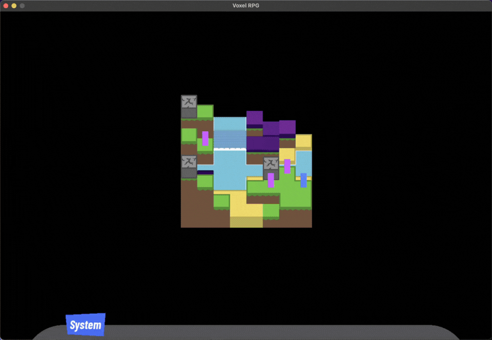

# Voxel Grid-Based RPG Game Engine & Collision System Prototype 
This is a custom 3D voxel rendering engine built from scratch using Pygame. 
I developed this to explore graphics pipeline and core RPG mechanics.
Voxels are rendered in a orthogonal style (i.e. Objects look the same at different distances, no distortion from perspective)
The game playstyle is close to strategic grid-based RPGs.

Due to bottleneck with performances, this shall be considered a "Completed Prototype". I am considering migrating this game to Unity or similar engines that are more suitable. [See Main Takeaway for more.](#main-takeaway)

## Demo Battle

Note that the test enemies are meant to be practice targets, so they won't act during their turn.

## Main Features:
- Voxel-based environment (Rendered orthogonally)
- Animated environments (e.g. Waterfalls)
- Dialogue System
- Various camera angles (Transition from side view to top down view)
- Character Information UI
- Projectile collision system (Line of Sight) via 3D-to-2D projections
- Different projectile types (Line of Sight Projectile & Raining Projectile)
- Combat (Target selection, projectiles, damage, status effects)

## Controls & Gameplay
- Your character has 2 Action Points by default, using Attacks and Spells will consume Action Points. 
- Hover over the moves (near bottom of the screen) for a quick preview of the move's power.
- Press SPACE to switch between top down view and side view.
- Press A or D to rotate the map by 90 degrees 
- Press the arrow keys to navigate the map. You can only move within the blue boundary. 
  - Characters can only move up 1 unit of height at a time. Some terrain like water are slightly lowered than usual, so you can only go from the water to coastal tiles.
- Press 1 to 4 to select a Action.
- Press Z to select a target or confirm an Action. Press 0 to unselect an Action.
- When attacking, press C to charge up the attack with elemental magic, which cause it to inflict a Status Effect. Press C again to discharge.
  - This will bring the attack's cost to from 1 to 2 Action Points.
- Press M to switch between "Action Selection" and "Character Information View".
- When viewing character info, move the cursor with the arrow keys.
- When the cursor is on a character, press Z to lock in for more information.

## Files
- VoxelGame_ATKProjectiles.py: Logic about the projectile's lifetime, trajectories and appearances.
- VoxelGame_BaseVars.py: Useful constants (colour palettes, fonts) and functions (e.g. LineOfSight check)
- VoxelGame_Dialogue.py: Manages the dialogue system
- VoxelGame_Equipment.py: Manages attack target selection's logic, UI and damage calculation.
- VoxelGame_Icons.py: Loads and prepares the icons used in the game. Placeholders are used in this version.
- VoxelGame_InfoCursor.py: Manages the character information view's logic and UI.
- VoxelGame_Skill.py: Manages skill target selection logic, UI and effect handling.
- VoxelGame_Stage.py: Manages the battlefield environment and camera view.
- VoxelGame_Unit.py: Manages the character's statistics, statuses, actions, movement and appearance.
- VoxelGame_Visuals.py: Manages the appearance of particles.
- VoxelGame.py: The driver. Creates the battlefield and units. 

## Main Logic
### Rendering Logic
- By keeping the view restricted to one of the cardinal directions or the top view, depth can be efficiently obtained from the Field Manager's array.
- In top down, every cuboid / voxel is a square. No occulsion calculation needed.
- From the side, since the view must be parallel to the depth axis, we can simply render from tiles row by row, from the back (0) to front (length-1). The 2D array structure already implies the depth.
- The orthogonal art style means each voxel only needs to render the top side and the front-facing side, which is less computationally expensive.

### Projectile and Particle Rendering
- In each iteration of the game loop, update the position and rotation of the projectile/particle.

### Projectile Collision (Line of Sight) Logic
- Extract the obstacles between the 2 character. Draw an imaginary line between the 2 characters.
- Project each obstacle and the imagianry line onto the XY, XZ, YX planes. 
- Collision in 3D space can only occur if collision occurs at the same relative point on all 3 2D planes.
- Use the built-in pygame.Rect.clipline() to handle collision detection between rectangles (projected obstacles) and the line (projected trajectory)

### Turn Logic
- For each faction's turn, once no one can still take anymore action, move to the next enemy.
- Field Manager keeps track of this.

## Set-up
- Download pygame on your device.
- Download the following fonts (as .tff) from Google Fonts and put them in a folder called "_Font"
  - barlow-condensed.tff
  - barlow-semi_condensed.tff
  - BlackHanSans-Regular.tff
  - Quicksand-SemiBold.tff
  - Make sure the file names matches
- Run VoxelGame.py

## Main Takeaway
### Optimization
- Orthogonal rendering is computationally cheaper since it can be achieved by ignoring distortion from depth, which would otherwise incur heavier matrix calculations for each object.
### Limitation
- pygame doesn't have GPU acceleration, instead relies on CPU to render.
- Rendering large environments may result in frame rates drops, leading to unsatisfying gameplay.
### Future Roadmap
- This game prototype shall be considered a completed prototype.
- Instead of attmepting to optimize on an engine not designed for 3D games, I am considering migrating to Unity or similar engines that can support maps on a bigger scale, allowing for more ambitious map designs and better graphics.
